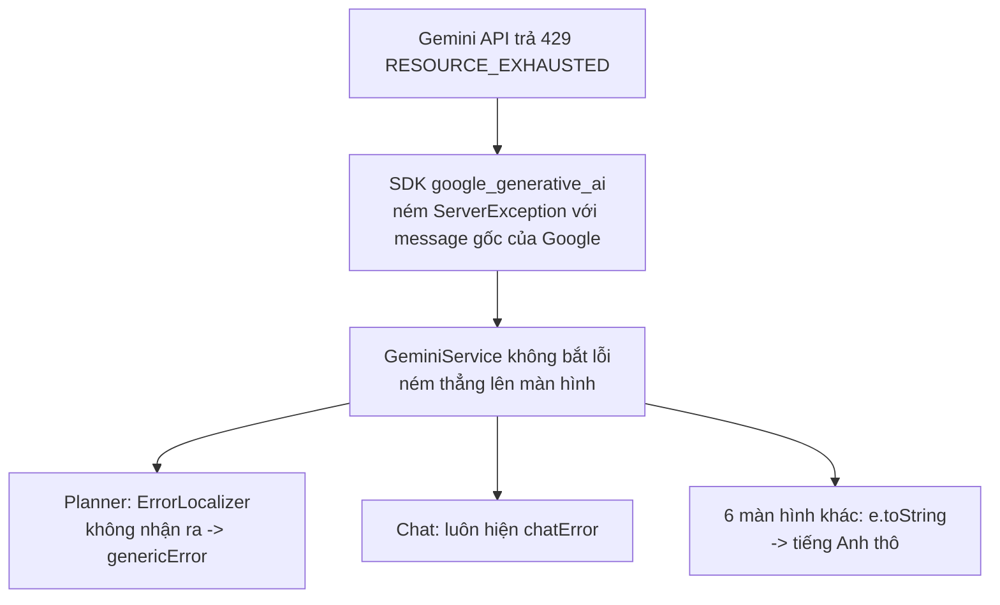

# Bài học: Báo đúng nguyên nhân khi AI lỗi (hết quota, hỏng key, mất mạng)

> Ngày: 11/10/2026. Người thực hiện: giáo viên hướng dẫn (harvy2702) cùng Claude.
> File liên quan: `lib/utils/error_localizer.dart`, `test/utils/error_localizer_test.dart`, 7 màn hình gọi `GeminiService`.

## 1. Tình huống

App dùng key Gemini miễn phí. Key miễn phí có giới hạn số lượt gọi mỗi phút và mỗi ngày. Trong buổi demo, nhiều người bấm cùng lúc, nên quota có thể hết giữa chừng.

Khi đó, app hiện các thông báo sau:

| Màn hình | Người demo thấy |
|---|---|
| Smart Planner ("Nhận gợi ý AI") | "Đã có lỗi xảy ra. Vui lòng thử lại." |
| Chat AI | "Xin lỗi, tôi không thể phản hồi. Vui lòng thử lại." |
| Chi tiết, Lịch trình, Explore, Best time, So sánh, Văn hoá | Một đoạn tiếng Anh dài của Google: "You exceeded your current quota, please check your plan and billing details..." |

Ở hai màn hình đầu, người demo không biết lỗi do đâu. Bấm "Thử lại" nhiều lần chỉ làm tốn thêm quota. Ở các màn hình còn lại, nguyên nhân có hiện, nhưng là tiếng Anh thô, rất dài, và không nói cần làm gì.

## 2. Nguyên nhân

Có hai vấn đề:

1. `ErrorLocalizer` chỉ biết 3 lỗi do app tự ném (`noAiResponse`, `apiKeyNotSet`, `loginRequired`). Mọi lỗi khác của Gemini rơi xuống câu chung "Đã có lỗi xảy ra".
2. Mỗi màn hình tự xử lý lỗi theo một kiểu. Có màn hình dùng `ErrorLocalizer`, có màn hình dùng `e.toString()`, có màn hình dùng câu cố định.

Một chi tiết của SDK cần biết: SDK **không** giữ mã HTTP (429, 403...). Nó chỉ giữ câu message tiếng Anh của Google. Vì vậy, muốn phân loại lỗi, chúng ta phải đọc chữ trong message:

| Lỗi thật | SDK ném ra | Chữ dùng để nhận ra |
|---|---|---|
| 429 hết quota | `ServerException` | `quota` hoặc `exhausted` |
| Key sai | `InvalidApiKey` | kiểu lỗi |
| Key bị lộ, bị khoá (401/403) | `ServerException` | `api key` |
| 500/503 máy chủ quá tải | `GenerativeAIException("Server Error [503]: ...")` | `server error` hoặc `overloaded` |
| JSON AI trả về bị hỏng | `FormatException` | kiểu lỗi |
| Mất mạng | `http.ClientException` | kiểu lỗi |

Bài học 1: trước khi viết code xử lý lỗi, hãy xem thư viện ném lỗi gì. Mở mã nguồn của package (ở đây là `~/.pub-cache/hosted/pub.dev/google_generative_ai-0.4.7/lib/src/error.dart`). Đừng đoán.

## 3. Cách sửa

1. Thêm nhánh vào `ErrorLocalizer` cho 5 loại lỗi ở bảng trên. Mỗi loại có một câu dễ hiểu và nói rõ cần làm gì.
2. Thêm 5 key l10n vào `app_vi.arb`, `app_en.arb`, `app_ko.arb`: `aiQuotaExceeded`, `aiKeyInvalid`, `aiServerBusy`, `aiInvalidResponse`, `networkError`.
3. Ở 7 màn hình gọi AI, thay `e.toString()` và `l10n.chatError` bằng `ErrorLocalizer.getLocalizedMessage(e, l10n)`.
4. Thêm `debugPrint` ở mỗi `catch`. Màn hình hiện câu dễ hiểu, còn lỗi gốc vẫn có trong Console để lập trình viên đọc.
5. Xoá key `chatError` vì không còn chỗ nào dùng.
6. Sửa `GeminiService.getDestinationDetail` ném `Exception('noAiResponse')` thay vì câu tiếng Việt viết cứng, để màn hình dịch được theo ngôn ngữ.

Sau khi sửa, khi hết quota, mọi màn hình đều hiện:

> AI đã hết lượt miễn phí (quota Gemini). Đợi khoảng 1 phút rồi thử lại, hoặc đổi Mô hình AI trong Hồ sơ.

Gợi ý "đổi Mô hình AI" có thật: mỗi model Gemini có quota riêng. Khi model này hết lượt, chọn model khác trong **Hồ sơ > Mô hình AI** thường gọi được tiếp.

Bài học 2: xử lý lỗi ở **một chỗ** (`ErrorLocalizer`), rồi mọi màn hình gọi chỗ đó. Khi Google đổi câu message, chỉ cần sửa một file và một file test.

Bài học 3: test viết trước, với message thật của Google. Xem `test/utils/error_localizer_test.dart`. Test chạy fail trước khi sửa (trả về câu chung), rồi pass sau khi sửa. Nhờ vậy chúng ta biết test kiểm đúng điều cần kiểm.

## 4. Mẹo cho buổi demo

1. Chạy thử trước một vòng các điểm đến sẽ demo. Kết quả AI được cache trong Hive, nên màn hình đã mở sẽ chạy được cả khi hết quota.
2. Không bấm "Thử lại" liên tục khi thấy thông báo hết quota. Mỗi lần bấm là một lượt gọi mới.
3. Trên bản web, mở DevTools (F12), tab Console, để xem lỗi gốc từ các dòng `debugPrint`.
4. Chuẩn bị sẵn một model dự phòng. Khi model chính hết quota, đổi model trong Hồ sơ.

## 5. Giới hạn

- Cách nhận lỗi dựa vào chữ trong message của Google. Nếu Google đổi câu chữ, lỗi sẽ rơi về câu chung "Đã có lỗi xảy ra". Khi đó, xem Console, rồi thêm chữ mới vào `ErrorLocalizer` và test.
- App không tự đợi rồi gọi lại (retry). Với project học tập, báo đúng nguyên nhân là đủ.

STE80
