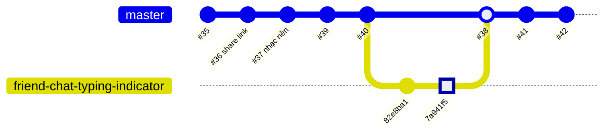

# Bài học: Code của PR đã merge bị mất sau một PR khác

> Ngày: 11/10/2026. Người thực hiện: giáo viên hướng dẫn (harvy2702) cùng Claude.
> PR liên quan: #36, #37 (bị mất code), #38 (gây mất code), PR khôi phục `fix/restore-pr36-pr37`.

## 1. Tình huống

Học sinh test lệnh chatbot "bật nhạc nền" / "tắt nhạc nền" trên master. Lệnh không hoạt động. Tính năng này đã có trong PR #37 và PR #37 đã merge thành công.

Khi kiểm tra master, toàn bộ code nhạc nền đã biến mất. Không ai xoá nó một cách cố ý.

## 2. Chuyện gì đã xảy ra

Commit `7a941f5` ("feat: enhance travel planning experience") nằm trong PR #38. Commit này dựa trên master mới nhất. Nhưng nội dung của nhiều file trong đó lại lấy từ một bản code **cũ**, khoảng thời điểm PR #35.

Bằng chứng:

| File | Nội dung trong `7a941f5` |
|---|---|
| `lib/models/ai_action.dart` | Giống từng byte với bản trước PR #37 |
| `test/models/ai_action_test.dart` | Giống từng byte với bản trước PR #37 |
| `lib/screens/auth_gate.dart` | Giống từng byte với bản trước PR #36 |
| `lib/services/friend_message_notification_service.dart` | Giống từng byte với bản trước PR #36 |
| `lib/utils/destination_share.dart` | Bị **xoá** (file này do PR #36 tạo ra) |
| `lib/screens/chat_screen.dart`, `lib/main.dart` | Bản cũ, cộng thêm thay đổi mới của #38 |

Git không báo conflict. Lý do: với Git, đây là một lần sửa file bình thường. Người viết commit "sửa" file về nội dung cũ, và Git tin đó là ý muốn của họ.

Nguyên nhân thường gặp của kiểu lỗi này:

- Làm việc trên một thư mục hoặc nhánh cũ nhiều ngày, rồi copy file sang thư mục mới để commit.
- Khi gặp conflict, chọn "Accept Current" / "Accept Theirs" cho cả file mà không đọc.
- Nhờ AI sửa code trong một bản copy cũ, rồi dán đè cả file vào repo.

Bài học 1: **PR merge thành công không có nghĩa là code sẽ ở lại mãi.** Một commit sau có thể ghi đè nó mà Git không cảnh báo.

## 3. Vì sao không ai phát hiện

1. PR #38 có 50 file thay đổi, hơn 4000 dòng. Không ai đọc hết được.
2. PR #38 merge mà không có review nào.
3. Trong tab "Files changed" có các dòng đỏ (bị xoá) thuộc code của người khác. Đây là dấu hiệu rõ nhất, nhưng không ai xem.
4. Một test đã hỏng ngay sau PR #38 (`share_destination_bottom_sheet_test.dart`), nhưng không ai chạy test trước khi merge.

## 4. Cách sửa

1. Tạo nhánh `fix/restore-pr36-pr37` từ master mới nhất.
2. Áp lại PR #36: `git cherry-pick -m 1 2884032`.
3. Giải conflict trong `share_destination_bottom_sheet.dart`. Giữ ý định của PR #36 (bỏ nút "Sao chép liên kết", vì link `voyz.app` không tồn tại). Giữ chữ "Gửi" đã dịch của PR #38.
4. Áp lại PR #37: `git cherry-pick -m 1 e4a69a8`.
5. Giải conflict trong `chat_screen.dart`. Giữ `languageCode` và `_openDestination` của PR #38. Thêm `musicAction` của PR #37.
6. Sửa `share_destination_bottom_sheet_test.dart`: thêm `localizationsDelegates`, vì PR #38 đã chuyển màn hình này sang `AppLocalizations`.
7. Chạy `flutter analyze` và chạy từng file test.

`-m 1` nghĩa là: lấy thay đổi của merge commit so với cha thứ nhất (master lúc đó). Nhờ vậy, ta áp lại đúng phần PR đã mang vào.

## 5. Cách tự kiểm tra trước khi tạo hoặc merge PR

1. Trước khi bắt đầu việc mới, chạy `git checkout master && git pull`, rồi tạo nhánh mới từ đó.
2. Không copy cả file từ thư mục khác hoặc từ bản AI sửa vào repo. Chỉ sửa đúng chỗ cần sửa.
3. Trước khi push, chạy `git diff origin/master...HEAD --stat`. Nếu có file mình không định đụng tới, dừng lại và xem.
4. Trên GitHub, mở tab "Files changed". Tìm dòng đỏ trong code mình không viết. Tìm file bị xoá.
5. Giữ PR nhỏ, mỗi PR một việc. PR 50 file thì không ai review nổi.
6. Chạy test liên quan trước khi merge. Test hỏng là tín hiệu có gì đó bị ghi đè.

Bài học 2: khi review, **dòng đỏ quan trọng hơn dòng xanh.** Dòng xanh là code mới. Dòng đỏ có thể là công sức của bạn mình vừa bị xoá.

STE80
